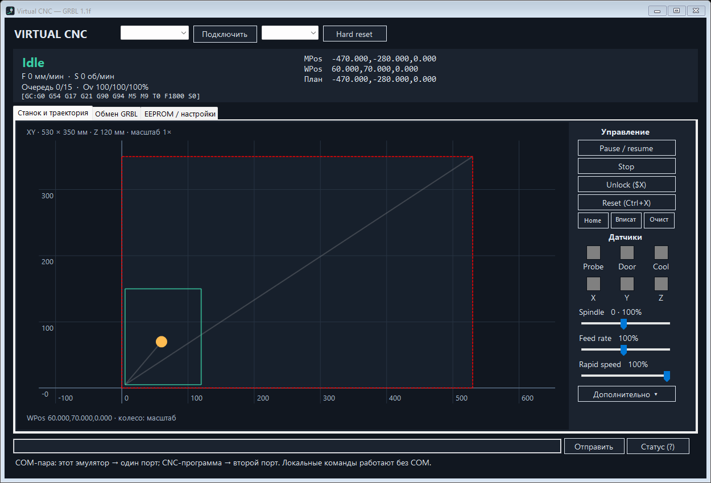

# Virtual CNC

Виртуальный трёхосевой CNC-станок для Windows на C# / .NET 10 с протоколом **GRBL 1.1f**. Подключается к управляющей программе через пару виртуальных COM-портов, исполняет G-code во времени и показывает стол, траекторию, шпиндель и датчики.

[Скачать последнюю версию](https://github.com/abukarenko/Virtual_CNC/releases/latest) · [Релизы](https://github.com/abukarenko/Virtual_CNC/releases) · [Сообщить об ошибке](https://github.com/abukarenko/Virtual_CNC/issues)



## Быстрый старт

1. Скачайте **VirtualCNC.exe** из раздела Releases. Это один файл для **Windows x64** со встроенным .NET; отдельно устанавливать runtime не требуется.
2. Поместите EXE в папку с правом записи и запустите. Рядом создаётся `data/eeprom.json` с настройками. Для переноса настроек скопируйте и этот файл.
3. Создайте связанную пару виртуальных COM-портов, например **COM14 ↔ COM15**.
4. В эмуляторе выберите **COM14**, скорость **115200** и нажмите «Подключить». В управляющей CNC-программе выберите **COM15**, ту же скорость, **8N1**, без управления потоком.
5. Проверьте обмен командами `$$`, `$I`, `$G` и `?`. Для включения поиска нуля отправьте `$22=1`, затем `$H` и дождитесь завершения.

Без COM доступны локальный ввод команд, датчики и просмотр траектории. Перед запуском новой версии завершите старую через «Выход» в трее, чтобы освободить порт.

## Виртуальные COM-порты

Приложению нужна **пара связанных портов**; само оно не устанавливает драйвер и не создаёт порты. Можно использовать [com0com](https://sourceforge.net/projects/com0com/) или другой совместимый драйвер. Совместимость подписи конкретной сборки драйвера зависит от Windows.

В исходниках есть помощник настройки com0com. После установки драйвера запустите PowerShell от администратора в папке проекта:

```powershell
.\scripts\Setup-ComPair.ps1 -EmulatorPort COM14 -SenderPort COM15
```

Список портов обновляется при раскрытии селектора. GUI предлагает скорости **115200, 250000 и 50000**; консольный COM-режим использует 115200. Оба конца пары должны иметь одинаковую скорость. Каждый порт открывает только одна программа.

Если появляется `Access to the path 'COM14' is denied`, проверьте, не работает ли прежний эмулятор в трее и не открыт ли этот порт в терминале. Управляющая программа должна использовать второй конец пары.

## Координаты и поиск нуля

**Машинные координаты GRBL отрицательные:** диапазон X — `[-$130, 0]`, Y — `[-$131, 0]`, Z — `[-$132, 0]`.

При первом запуске приложение сохраняет **рабочий ноль XY в левом нижнем углу стола** через смещение G54:

```text
G54 X = -$130
G54 Y = -$131
G54 Z = прежнее значение
```

Это настройка приложения поверх стандартного GRBL, а не изменение машинного пространства. Настройка применяется один раз и отмечается в EEPROM. Последующие изменения G54 через G10, выбор G55–G59 и временное смещение G92 работают обычным образом и не перезаписываются при запуске.

При `$23=3` поиск нуля сначала поднимает Z к верхнему концевику, затем ведёт X/Y в отрицательном направлении, к левому нижнему углу. Каждая ось останавливается при собственном контакте. Выполняются отход, повторное медленное касание и окончательный отход на `$27`.

Для `$130=530`, `$131=350`, `$132=120`, `$27=5` результат при исходном G54 и без дополнительных смещений:

| Ось | Машинная позиция после `$H` | Рабочая позиция |
|---|---:|---:|
| X | −525 | 5 |
| Y | −345 | 5 |
| Z | −5 | −5 при нулевом смещении Z |

Рабочая позиция вычисляется как **WPos = MPos − WCO**. WCO включает выбранную систему G54–G59, G92 и коррекцию длины инструмента. Поиск нуля сам по себе не устанавливает ноль детали по Z.

Если изменились размеры стола, скорректируйте G54, например для 530 × 350 мм:

```gcode
G10 L2 P1 X-530 Y-350
```

Эта команда меняет XY G54 и сохраняет его Z. Для проверки программных ограничений включите `$20=1` после homing. Положительные координаты рабочей программы будут соответствовать движению внутрь стола при описанном G54.

## Интерфейс

- **Станок и траектория.** Красная пунктирная рамка показывает габариты `$130/$131` с сохранением пропорций; `$132` задаёт диапазон Z. Жёлтый шпиндель меняет диаметр от 5 пикселей внизу до 20 наверху. При `$H` видно его движение, без рабочего следа.
- **Масштаб.** Стол вписывается в окно. Колесо мыши меняет масштаб вокруг указателя; «Вписать» или двойной щелчок левой кнопкой возвращает общий вид.
- **Траектория.** G0 рисуется серым с прозрачностью 70%, G1/G2/G3 — зелёным. Тип участка берётся из исполняемого блока. След хранится в машинных координатах; смена рабочего нуля не перемещает его относительно физического стола. Сетка показывает активные рабочие координаты.
- **Обмен GRBL.** Журнал входящих команд, ответов и событий. Полный диагностический COM-обмен сохраняется отдельно в `data/serial.log` рядом с EXE.
- **EEPROM.** Номер настройки, значение и пояснение занимают 15/15/70% ширины. Значения можно редактировать; изменения через COM также появляются в таблице.

### Управление и датчики

`Pause / resume` выполняет `!` / `~`. `Stop` и `Reset (Ctrl+X)` выполняют программный сброс GRBL. `Unlock ($X)` снимает блокировку; `Home` запускает `$H`. «Очистить» удаляет отображаемую траекторию.

**Hard reset** имитирует перезапуск микроконтроллера: обнуляет счётчик машинной позиции и временные состояния, сохраняя EEPROM и физические входы. При `$22=1` снова требуется homing. Программный Ctrl+X сохраняет машинную позицию, но сбрасывает G92, модальные состояния, overrides и выходы; сброс во время движения вызывает тревогу.

Квадраты датчиков переключаются нажатием или пробелом:

| Индикатор | Активный цвет | Назначение |
|---|---|---|
| Probe | Жёлтый | Контакт щупа |
| Door | Фиолетовый | Открытая защитная дверь |
| Cool | Голубой | Состояние и переключение охлаждения |
| X / Y / Z | Красный / зелёный / синий | Концевики соответствующих осей |

Неактивные квадраты серые. Ползунки меняют коррекцию скорости шпинделя и подачи; быстрый ход имеет уровни 25/50/100%. В «Дополнительно» доступны плоскость контакта щупа по Z и скорость симуляции.

При сворачивании окно скрывается в трей, а эмуляция и соединение продолжаются. Двойной щелчок по значку возвращает окно. «Выход» в трее или закрытие окна завершает приложение.

## Поддерживаемый протокол

| Категория | Команды |
|---|---|
| Движение | G0, G1, G2, G3, G38.2–G38.5, G80 |
| Координаты | G10 L2/L20, G28/G28.1, G30/G30.1, G53, G54–G59, G92/G92.1 |
| Режимы | G17–G19, G20/G21, G90/G91, G91.1, G93/G94, G40, G43.1/G49, G61 |
| Пауза и конец | G4 P…, M0, M1 (игнорируется), M2, M30 |
| Шпиндель и СОЖ | M3/M4/M5, M8/M9; M7 при `--mist` |
| Система | $, $$, $#, $G, $I, $I=…, $N, $N0/1=…, $x=…, $J=…, $H, $X, $C, $SLP, $RST=$/#/* |
| Реальное время | ?, !, ~, Ctrl+X, safety door 0x84, jog cancel 0x85 |
| Overrides | 0x90–0x97, 0x99–0x9E, 0xA0; 0xA1 при `--mist` |

Реализованы 34 стандартные настройки, проверки модальных групп и параметров, ошибки GRBL, планировщик на 15 блоков, RX на 127 используемых байтов и строка до 79 символов после удаления пробелов/комментариев. Realtime-байты обрабатываются даже внутри незавершённой строки. Ответы COM завершаются CRLF.

M6, G81–G89, G90.1 и опциональная parking-команда M56 не поддерживаются. При передаче программы ожидайте `ok`/`error` или используйте подсчёт символов RX-буфера.

## Память и дополнительные режимы

В JSON сохраняются настройки, G54–G59, G28/G30, строки запуска и `$I=`. Запись атомарная. Повреждённый файл сохраняется как `.corrupt-*`, затем загружаются значения по умолчанию. Временные состояния G92 и overrides в EEPROM не записываются.

Следующие примеры для исходного дерева используют `Start.cmd`; у скачанного EXE те же параметры доступны напрямую:

```powershell
.\Start.cmd --connect COM14       # GUI с автоматическим подключением
.\Start.cmd --port COM14          # консольный COM, 115200 8N1
.\Start.cmd --list-ports
.\Start.cmd --memory D:\CNC\eeprom.json
.\Start.cmd --tcp 7000            # 127.0.0.1, один клиент одновременно
.\Start.cmd --stdio               # бинарный протокол stdin/stdout
.\Start.cmd --speed 10            # ускорение симуляции в 10 раз
.\Start.cmd --mist                # опциональная поддержка M7
```

## Сборка и проверка

Нужны Windows x64 и **.NET 10 SDK**. Эталон GRBL подключён как Git submodule; для компиляции C# он не требуется.

```powershell
git clone --recurse-submodules https://github.com/abukarenko/Virtual_CNC.git
cd Virtual_CNC
.\scripts\Build-Portable.ps1
```

Скрипт создаёт иконку, запускает проверки ядра, собирает единый `VirtualCNC.exe` и проверяет обмен с отдельным процессом через TCP. Перед сборкой закройте запущенный EXE, чтобы Windows позволила его заменить.

Другие проверки:

```powershell
dotnet run --project tests\VirtualCnc.Tests -c Release
.\scripts\Test-Transport.ps1 -ExecutablePath .\VirtualCNC.exe
# Для реального COM-теста: эмулятор на COM14, COM15 освобождён.
dotnet run --project tests\VirtualCnc.SerialProbe -- COM15
```

Версия 1.0.0 проверена 102 тестами ядра и тестом TCP-транспорта. Во время разработки также проверены COM14 ↔ COM15 и выполнение программы примерно на 1200 строк через управляющую программу.

## Границы совместимости

Это самостоятельная реализация на C#, сверенная с GRBL **v1.1f.20170801**, commit `5967839ab38f8e984a384db1f64e781cffb9e739`. AVR-код не исполняется; полная побайтовая и временная эквивалентность прошивке не подтверждена.

- Ускорения и look-ahead моделируются программно; нет электрических STEP/DIR, AVR-прерываний, AMASS и аппаратного PWM.
- Дуги хранятся геометрическими блоками; `$12` сохраняется, но не задаёт сегментацию дуг. Наполнение планировщика и время подтверждений могут отличаться.
- Hold, door и jog cancel останавливают движение сразу; аппаратное торможение и промежуточные Hold:1 / Door:2/3 не моделируются.
- Homing учитывает границы, контакты, debounce, повторный подход и отход, но движется без аппаратного профиля ускорений. Ручной удерживаемый концевик даёт ALARM:8; отсутствие виртуального контакта — ALARM:9; сброс и дверь при homing — ALARM:6/7.
- Периодичность WCO/Ov, некоторые ответы и числовые граничные случаи могут отличаться; C# использует `double`, AVR — `float`.
- Начальное G54 в левом нижнем углу — дополнительная настройка этого приложения. Инверсии физических пинов сохраняются, но электрические сигналы не генерируются.

## Структура и лицензия

- `src/VirtualCnc.Core` — протокол, парсер, EEPROM, механика и датчики.
- `src/VirtualCnc.App` — Windows Forms, COM, TCP и stdio.
- `tests` — проверки ядра и COM.
- `scripts` — сборка, иконка, com0com и проверка транспорта.
- `assets` — иконка и изображение интерфейса.
- `vendor/grbl` — submodule эталонной прошивки.

**GPL-3.0-or-later**, полный текст в [LICENSE](LICENSE). Эталон GRBL сохраняет собственные уведомления об авторстве: Sungeun K. Jeon / Gnea Research LLC и Simen Svale Skogsrud.

Источники: [GRBL 1.1f](https://github.com/gnea/grbl/tree/v1.1f.20170801), [интерфейс](https://github.com/gnea/grbl/wiki/Grbl-v1.1-Interface), [настройки](https://github.com/gnea/grbl/wiki/Grbl-v1.1-Configuration).
